# Lofi Ice Escape

<p align="center">
  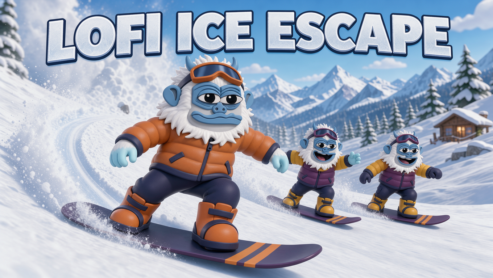
</p>

**Lofi Ice Escape** is a 3D browser snowboarding game built for the **Sui** ecosystem (**CLAY Hackathon III**). Play as **Lofi** and lead your growing crew of **Lil Yetis** down alpine slopes, carving past obstacles, hitting optional ramps, controlling speed on steep descents, and outrunning the avalanche to reach the warm **Shelter**.

- **Live Demo:** https://lofiescape.fun
- **Demo Mode:** Playable immediately with no wallet required.
- **Sui Integration:** Optional Sui Wallet connection (Nightly, Slush, Backpack, OKX) for Rider Profile, Daily Check-In, 7 Claimable Badges, and Leaderboard.

---

## Screenshots

<p align="center">
  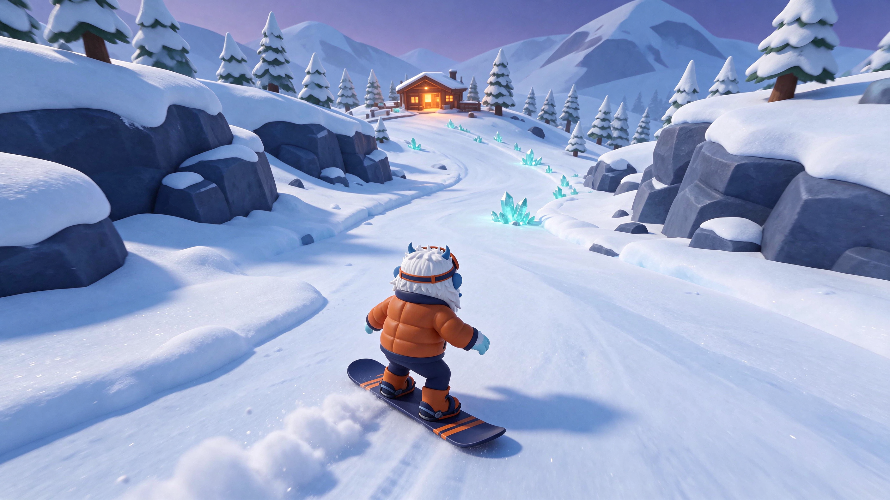
  
</p>
<p align="center">
  
  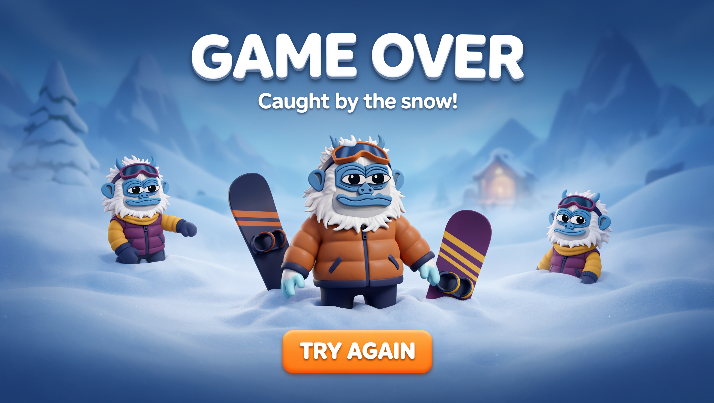
</p>

---

## Rider Avatars

Connect any Sui Wallet to choose your rider avatar and set your verified username:

| Goggles | Beanie | Shades | Headphones |
| :---: | :---: | :---: | :---: |
|  |  | 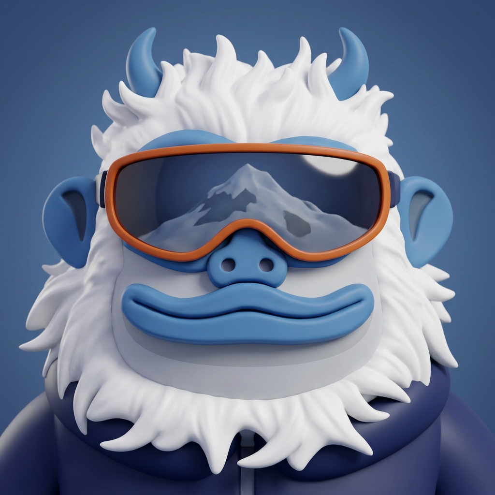 |  |

---

## 7 Claimable Sui Badges

Complete in-game milestones and claim each badge via `sui:signPersonalMessage`:

| Badge | Name | Unlock Requirement |
| :---: |---|---|
| 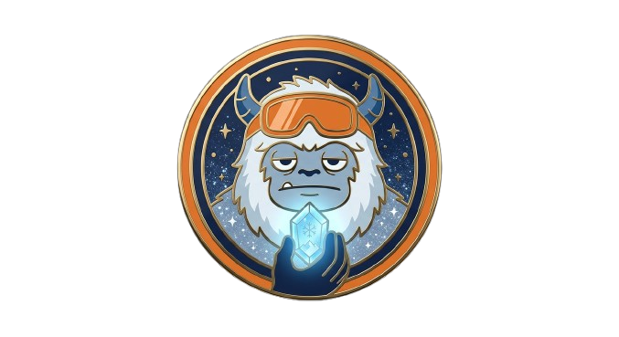 | **New User Verified** | Connect Sui wallet & save username |
| 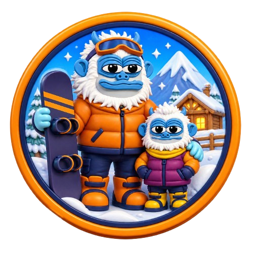 | **First Shelter** | Complete Level 1 solo |
| 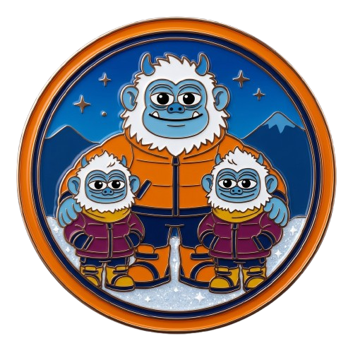 | **Growing Crew** | Complete Level 3 (*First Drop*) |
| 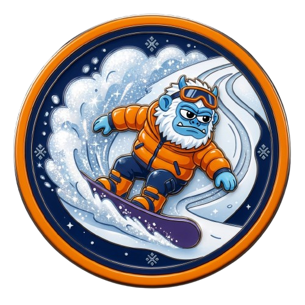 | **Carving Master** | Complete Level 4 (*Carving Pass*) |
| 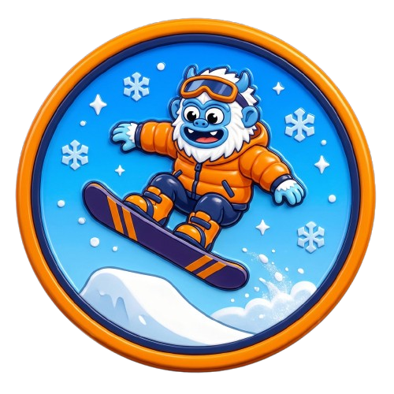 | **Airborne Yeti** | Complete Level 5 (*Drop & Jump*) |
| 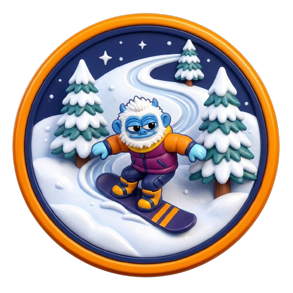 | **Slalom Pro** | Complete Level 6 (*Pine Slalom*) |
| 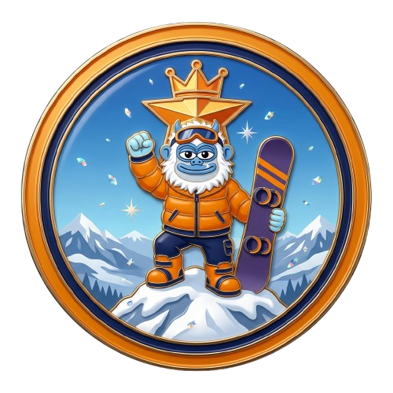 | **Summit Champion** | Complete Level 10 (*Summit Run*) with all 9 Lil Yetis |

---

## Controls

| Action | Desktop | Mobile |
|---|---|---|
| Steer Left / Right | `A` / `D` or `←` / `→` | On-screen steering |
| Brake (Steep Descent) | Hold `S` or `↓` | Hold **BRAKE** button |
| Jump / Trick | `Space` (on ramps) | On-screen jump |

---

## 10-Level Progression

Every completed level recruits **1 new Lil Yeti** at the Shelter to join your crew for the next run (`Level N = Lofi + N−1 Lil Yetis`):

1. **Level 1** — Lofi rides solo
2. **Level 2** — 1 Lil Yeti
3. **Level 3: First Drop** — Steep Descent & Brake introduction (2 Lil Yetis)
4. **Level 4: Carving Pass** — S-curve carving (3 Lil Yetis)
5. **Level 5: Drop & Jump** — Optional ramp vs. safe route (4 Lil Yetis)
6. **Level 6: Pine Slalom** — Zig-zag pine slalom (5 Lil Yetis)
7. **Level 7: Avalanche Alley** — Downhill, flat momentum, downhill (6 Lil Yetis)
8. **Level 8: Rock Garden** — Multi-route rock choices (7 Lil Yetis)
9. **Level 9: Double Drop** — Two steep descents with recovery (8 Lil Yetis)
10. **Level 10: Summit Run** — Final combined challenge (9 Lil Yetis)

---

## Tech Stack

- **Frontend:** React 19, TypeScript, Vite, Tailwind CSS v4
- **3D Engine:** Three.js
- **Blockchain:** Sui Wallet Standard (`sui:signPersonalMessage`), Sui Testnet RPC (`VITE_SUI_RPC_URL`)

---

## Run Locally

```bash
npm install
npm run dev
```

Optional `.env`:

```env
VITE_SUI_RPC_URL=https://fullnode.testnet.sui.io:443
```

---

## License

Licensed under the [MIT License](LICENSE).
